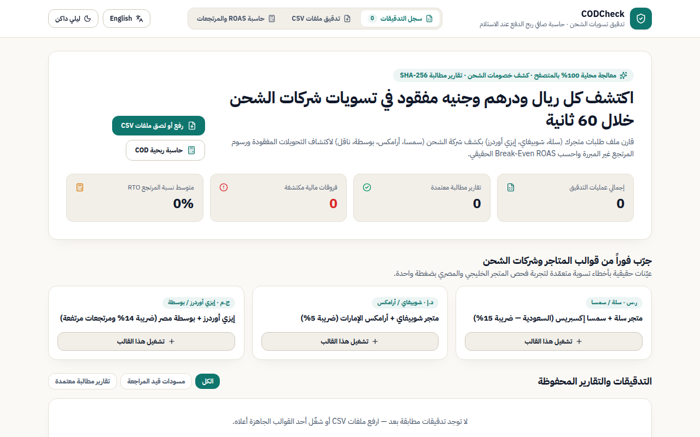
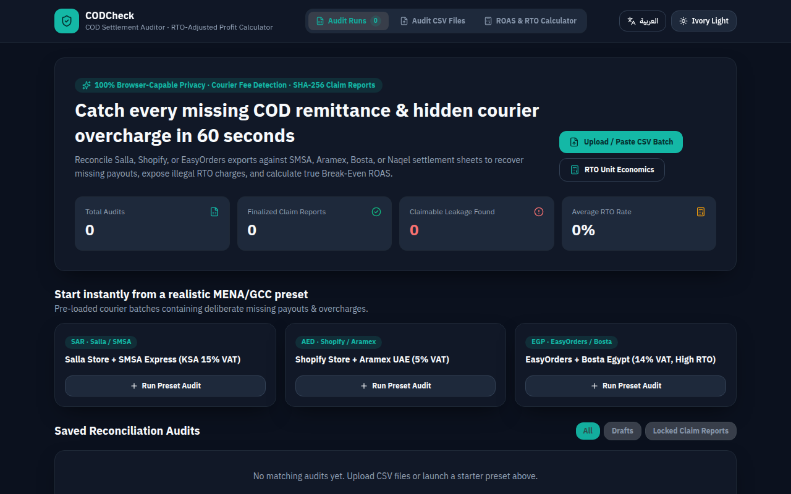
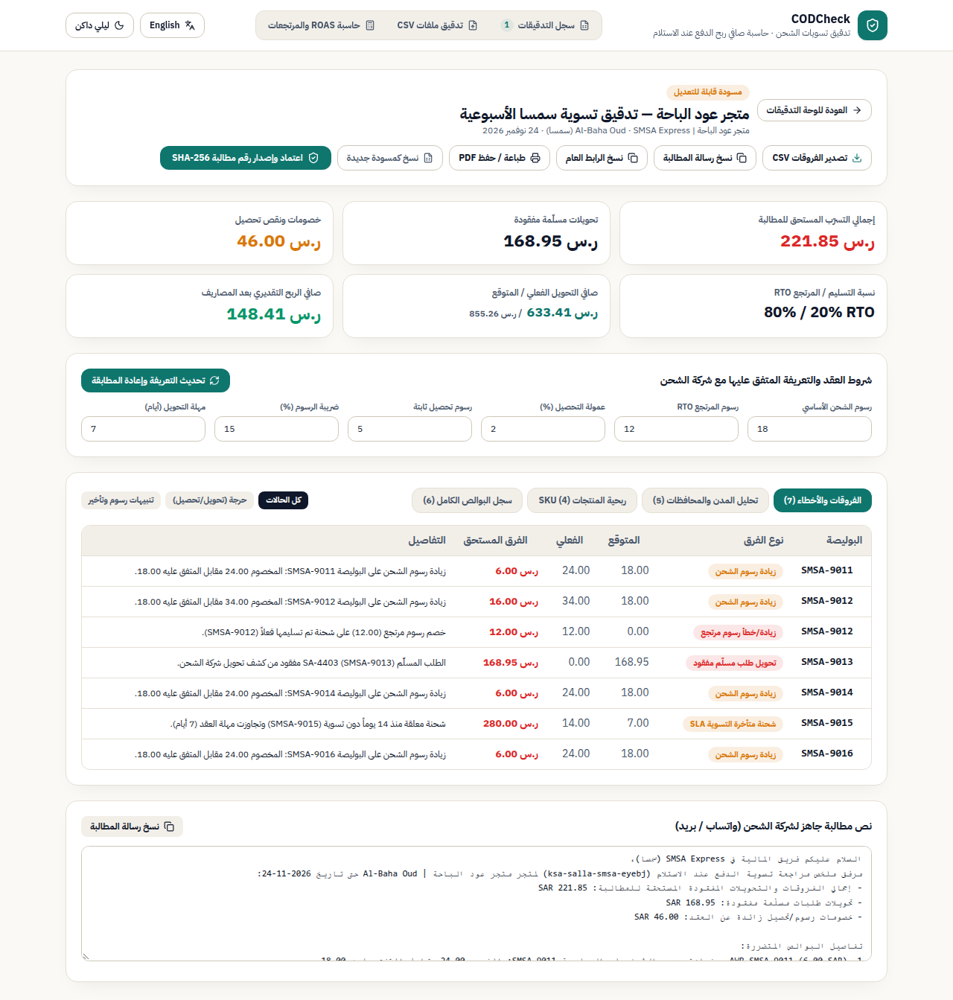
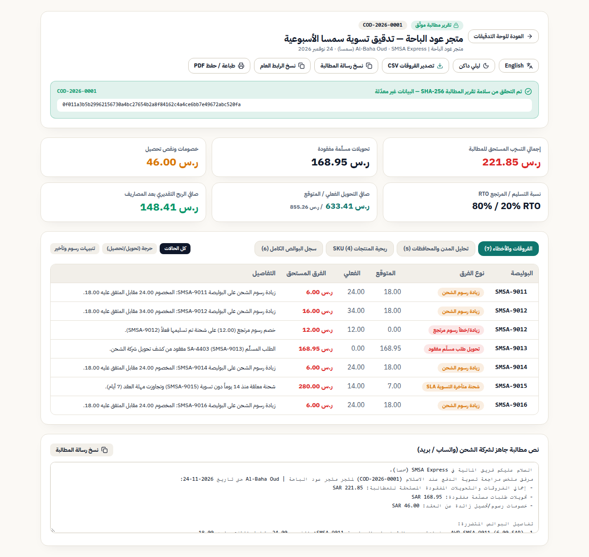
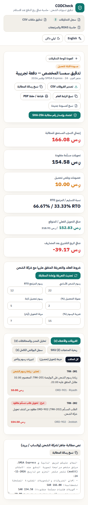
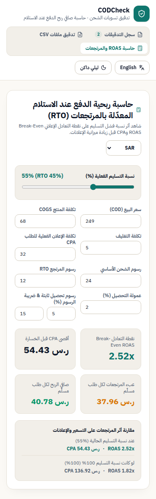

# CODCheck

[](https://github.com/manea/codcheck/actions/workflows/ci.yml)
[](LICENSE)
**Client-Side COD Courier Settlement Auditor, Overcharge & Missing Remittance Detector & RTO-Adjusted Break-Even ROAS Calculator for MENA/GCC Stores (`AR RTL / EN LTR`).**

**مدقق تسويات الدفع عند الاستلام (`COD`) لكشوف شركات الشحن (`سمسا، أرامكس، بوسطة، ناقل`)، وكاشف التحويلات المفقودة وفروقات الرسوم، وحاسبة نقطة التعادل الإعلاني (`Break-Even ROAS / CPA`) المعدّلة بالمرتجعات `RTO`.**

- **مستودع المصدر المفتوح (GitHub — MIT)**: [`https://github.com/manea/codcheck`](https://github.com/manea/codcheck) (`v0.5.0` + GitHub Actions CI).

Designed for **Salla, Shopify, EasyOrders, and WooCommerce** merchants across Saudi Arabia (`SAR` / 15% VAT), the UAE (`AED` / 5% VAT), Egypt (`EGP` / 14% VAT), and wider GCC/MENA — featuring dual **Ledger Ivory** (`#FBF9F5`) light and **Vault Slate** (`#0B111E`) dark themes, Arabic RTL by default, and English LTR support.

---


## UI Previews (لقطات من الواجهة)

### Studio Dashboard — Arabic RTL (`Ledger Ivory Light`)


### Studio Dashboard — English LTR (`Vault Slate Dark`)


### Settlement Audit Workspace & Discrepancy Table (Desktop)


### Locked Public Claim Report (`COD-YYYY-0001` & SHA-256 Digest)


### Mobile Arabic RTL Settlement Audit (`390x844`)


### Mobile Arabic RTL Break-Even ROAS Calculator (`390x844`)


---
## Core Capabilities (المزايا الأساسية)

- **Zero-Dependency Store vs. Courier Reconciliation (`src/core/reconcile.ts`)**:
  - Auto-detects bilingual Arabic/English columns from Salla, Shopify, EasyOrders, SMSA, Aramex, Bosta, and Naqel exports.
  - Flags **Missing COD Remittances**, **Short COD Collected**, **Shipping Fee Overcharges**, **RTO Fee Overcharges on Delivered Orders**, **COD Collection Commission Overcharges**, **Aging Unsettled Shipments Past Contract SLA**, **Duplicate AWB Rows**, and **Unmatched Courier AWBs**.
- **RTO-Adjusted Unit Economics & Break-Even ROAS (`src/components/UnitEconomicsCalc.tsx`)**:
  - Shows how return-to-origin (`RTO`) rates shift true **Break-Even ROAS**, **Break-Even CPA**, **RTO Cost Burn per Delivered Order**, and **Net Profit per Delivered Order** compared against a naive 100% delivery baseline.
- **Courier Claim Reports (`COD-YYYY-0001`) & SHA-256 Digest**:
  - Atomic sequential numbering (`COD-YYYY-0001`), canonical `SHA-256` payload digest, post-finalization lock (`409 AUDIT_LOCKED`), live `verifyAuditIntegrity` tamper check, ready-to-send Arabic/English WhatsApp/email courier dispute letters, A4 print/PDF styling, and CSV injection-safe **UTF-8 BOM** exports.
- **Offline / Static `$0` Browser Fallback**:
  - Works seamlessly without a backend on Cloudflare Workers Static Assets via automatic `localStorage` fallback in `src/lib/api.ts`.

---

## Quickstart (التشغيل السريع محلياً)

```bash
cd projects/codcheck
npm install
npm run typecheck
npm test
npm run build
npm start
# Opens CODCheck on http://127.0.0.1:4185
```

### Scripts
- `npm run dev` — Run Vite dev server (`127.0.0.1:5173`, proxying `/api` to `:4185`).
- `npm run typecheck` — Run TypeScript type check (`tsc --noEmit`).
- `npm test` — Run Vitest core & server integration suite (`tests/unit/codcheckCore.test.ts`, `tests/unit/codcheckServer.test.ts`).
- `npm run build` — Build production bundle into `dist/`.
- `npm run test:e2e` — Run Chromium Playwright E2E suite across `1280x800` desktop & `390x844` mobile (`tests/e2e/codcheck.spec.ts`).
- `npm run start:lan` — Serve production build & API on `0.0.0.0:4185`.

---

## API Reference (`server/app.mjs`)

- `GET /api/health` — Service health, version, `basePath`, and SQLite audit/tariff counts.
- `GET /api/presets` — Built-in MENA/GCC starter presets (`ksa-salla-smsa`, `uae-shopify-aramex`, `eg-easyorders-bosta`).
- `POST /api/unit-economics` — Server-side RTO unit economics computation (`computeCodUnitEconomics`).
- `GET|POST /api/tariffs` & `PATCH|DELETE /api/tariffs/:id` — Manage saved courier contract tariff profiles.
- `GET|POST /api/audits` — List saved audits + summary metrics, or create an audit from a `presetId` or raw CSV batch.
- `GET|PATCH|DELETE /api/audits/:id` — Read, recalculate contract tariffs/rows (`draft` only), or delete an unlocked audit.
- `POST /api/audits/:id/duplicate` — Clone any audit (including locked `COD-YYYY-0001` claim reports) into a fresh editable draft.
- `POST /api/audits/:id/finalize` — Assign atomic `COD-YYYY-0001` claim number + `SHA-256` digest and lock permanently against mutation.
- `GET /api/audits/:id/export.csv` — Formula-safe **UTF-8 BOM** CSV discrepancies & orders export (`?locale=ar|en`).
- `GET /api/audits/:id/dispute-message` — Ready-to-send courier claim letter in Arabic or English.
- `GET /api/public/reports/:slugOrNumber` — Shareable read-only claim report payload by `slug` or `COD-YYYY-0001` (increments `viewCount`).

---

## `$0` Deployment & Sharing

See [`launch/DEPLOY-AND-SHARE.md`](launch/DEPLOY-AND-SHARE.md) for Cloudflare Workers Static Assets (`wrangler.jsonc`), Docker (`Dockerfile`, `docker-compose.yml`), `systemd` + Caddy/Tailscale (`deploy/`), SQLite online backup (`deploy/backup-sqlite.sh`), and zero-budget community sharing drafts.
